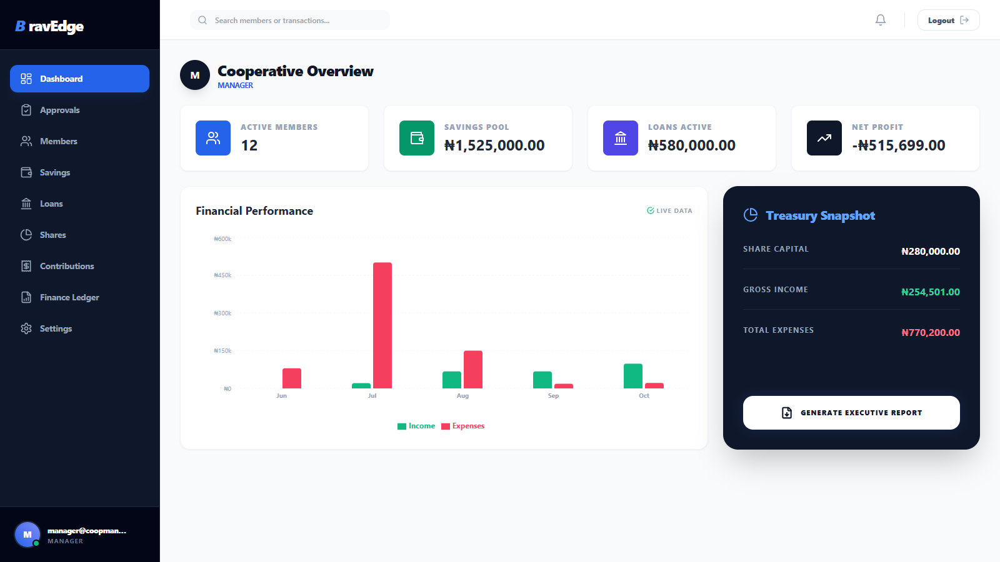
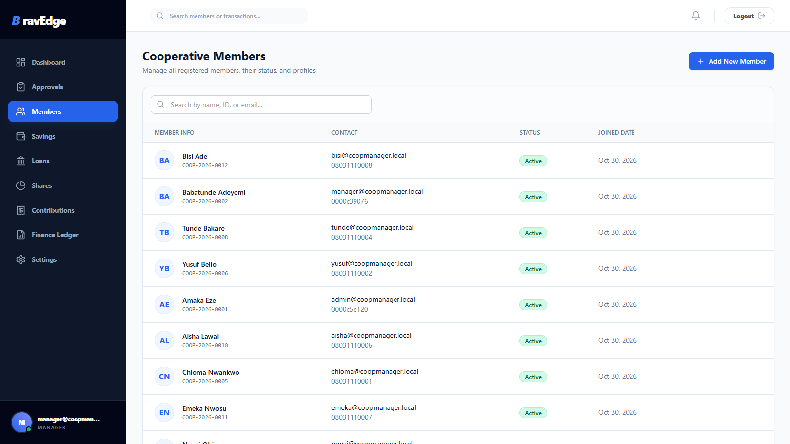
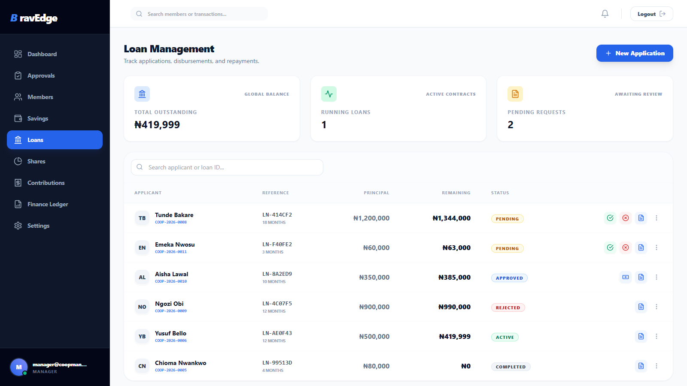
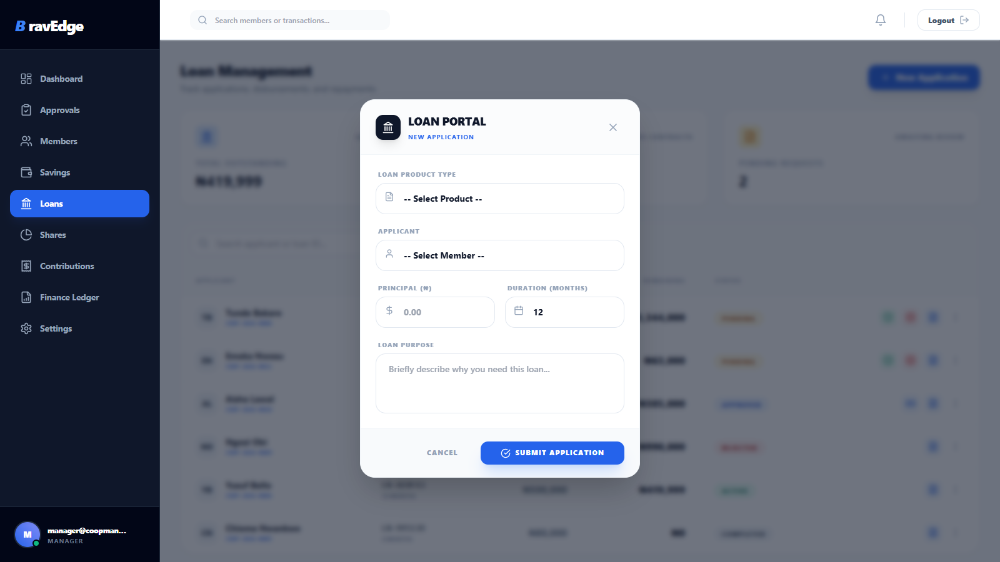
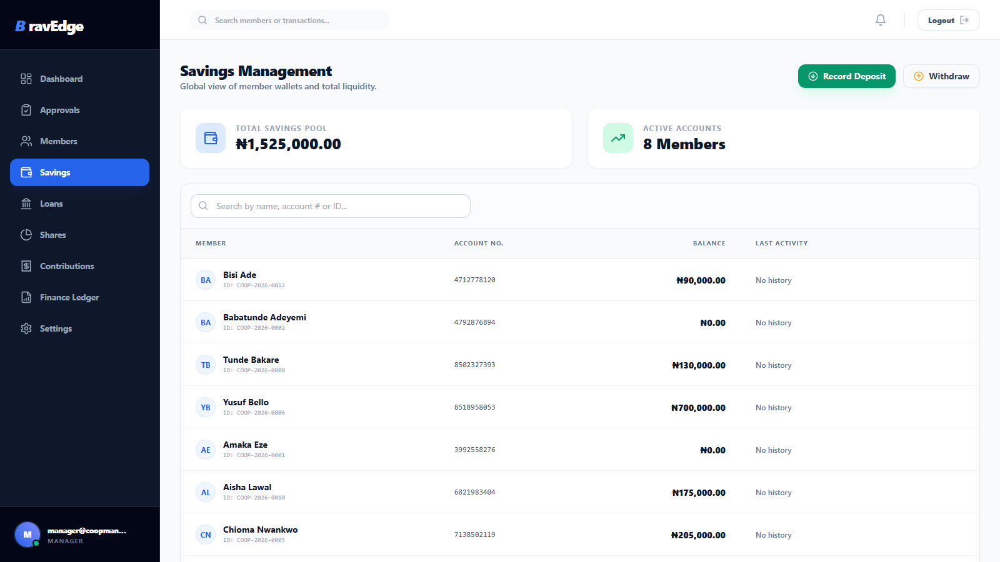
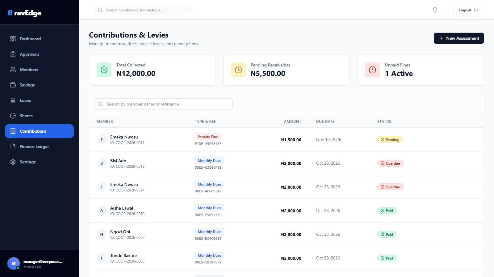
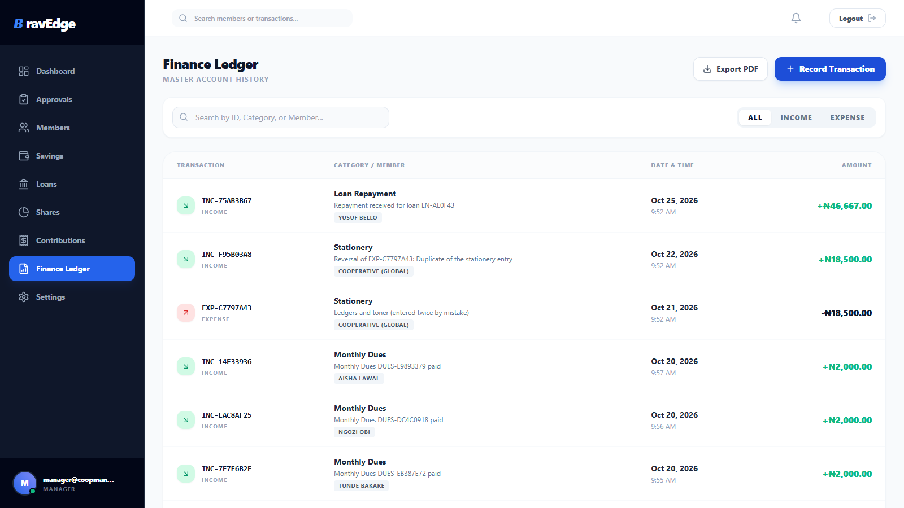

# CoopManager Pro 🏢

An advanced, full-stack Cooperative Management System designed to handle members, savings, loans, shares, contributions, and general cooperative finances.

## 🌟 Features

* **Role-Based Access Control (RBAC):** Distinct dashboards and permissions for Super Admins, Managers, Loan Officers, and standard Members.
* **Member Management & KYC:** Track member profiles, next of kin, and securely upload/verify KYC documents.
* **Savings & Wallets:** Manage individual member savings accounts, deposits, withdrawals, and dividend payouts.
* **Loan Processing:** Configurable loan products, application workflows, guarantor approvals, and automated repayment tracking.
* **Share Capital Management:** Track total cooperative shares, unit prices, and member shareholdings.
* **Contributions & Fines:** Automate mandatory/voluntary dues, levies, and penalty tracking.
* **Financial Ledger:** Global cooperative income and expense tracking.
* **Analytics Dashboard:** Real-time visual metrics using Recharts.
* **Approvals Queue:** Finance staff approve or decline members' savings and share requests in one place; nothing moves until they do.

## 🛡️ Money Integrity & Security

* **One locked path for every balance change.** Savings, loans, shares and dues each have a service (`apps/*/services.py`) that locks the account row, checks the rules and records the ledger entry in the same transaction. Two clicks at the same moment can't double-count, and no account can go below zero.
* **Permanent records.** Transactions, repayments, dues and ledger entries are never edited or deleted. A ledger mistake is corrected with a reversing entry that points back at the original.
* **Separation of duties.** Members can only request; staff approve. Nobody approves, disburses or decides on their own loan. Repayments are recorded only by staff, and can't exceed what is owed. The share price comes from Settings, never from the request.
* **Daily integrity check.** `python manage.py reconcile` compares every savings, loan and share balance with the transactions behind it and exits non-zero on any discrepancy.
* **Safe sign-in.** The refresh token lives in an httpOnly cookie, the access token only in memory; logout revokes the session; sign-in and sign-up are rate-limited. Public sign-up always creates an unapproved member.
* **Safe defaults.** `DEBUG` is off unless set, a `SECRET_KEY` is required, and no password is written in the code.
* **Tests.** 65 API tests cover the money rules above (`python manage.py test apps --settings=config.settings_test`).

> **Upgrading from an earlier version?** Before these fixes, approved savings transactions could be counted twice. Run `python manage.py reconcile` once after upgrading and review any account it lists.

## 📸 System Preview

### 🖥️ Admin Dashboard
The central hub for system administrators to monitor liquidity, active members, and treasury health.


### 👥 Member Management
Track registered members, their status, and detailed financial profiles.


### 💰 Loans & Credit Portal
A robust engine for managing loan products, applications, and repayment tracking.



### 🏦 Savings & Contributions
Manage member wallets, total liquidity pool, and mandatory levies.



### 🧾 Finance Ledger
A master account history for tracking every income and expense transaction within the system.



## 🛠️ Tech Stack

**Backend**
* Python 3.10+
* Django 5.0 & Django REST Framework
* PostgreSQL
* Simple JWT (JSON Web Tokens)

**Frontend**
* React 18 (Vite)
* Tailwind CSS
* React Router v6
* Axios (with automated interceptors)
* Lucide React & Recharts

**Database:** PostgreSQL (Hosted on Render)
**Deployment:** GitHub Pages (Frontend) & Render (Backend)
**DevOps:** Docker, Docker Compose

## 📋 Prerequisites

Before you begin, ensure you have the following installed:
* [Node.js](https://nodejs.org/) (v18.0 or higher required for Vite)
* [Python](https://www.python.org/downloads/) (v3.10 or higher)
* [PostgreSQL](https://www.postgresql.org/) (running locally or via Docker)

---

## 🚀 Local Development Setup

### 1. Database Setup
Create a new PostgreSQL database. You can do this via pgAdmin or the psql CLI:
```sql
CREATE DATABASE cooperative_db;
CREATE USER coop_user WITH PASSWORD 'choose-a-strong-password';
GRANT ALL PRIVILEGES ON DATABASE cooperative_db TO coop_user;
```

Or with Docker: copy `.env.example` to `.env`, set `DB_PASSWORD`, then `docker compose up`.

### 2. Backend Setup
Navigate to the backend directory, set up your virtual environment, and install dependencies.

```bash
cd backend

# Create and activate virtual environment
python -m venv venv
# On Windows: .\venv\Scripts\Activate.ps1
# On Mac/Linux: source venv/bin/activate

# Install requirements
pip install -r requirements.txt
```

**Environment Variables**
Copy `backend/.env.example` to `backend/.env` and fill it in. For local development set `DEBUG=True`,
`AUTH_COOKIE_SECURE=False` and `CORS_ALLOWED_ORIGINS=http://localhost:5173`.

**Migrate & Run**
```bash
# Apply database migrations
python manage.py migrate

# Create your admin account
python manage.py createsuperuser

# Start the server
python manage.py runserver
```
*The backend API will run on `http://127.0.0.1:8000`*

**Quick try without PostgreSQL**
```bash
python manage.py migrate --settings=config.settings_local
python manage.py seed_demo --settings=config.settings_local      # demo cooperative, dates relative to today
python manage.py runserver --settings=config.settings_local
```
`seed_demo` only runs with `DEBUG` on. Its accounts (`admin@`, `manager@`, `accountant@`, `loans@`,
and members such as `chioma@coopmanager.local`) share the demo password in
`backend/apps/core/management/commands/seed_demo.py`. Reload it with `seed_demo --reset`.

**Tests and integrity check**
```bash
python manage.py test apps --settings=config.settings_test   # in-memory SQLite
python manage.py reconcile                                   # read-only; exit 1 on any discrepancy
```

### 3. Frontend Setup
Open a new terminal window, navigate to the frontend directory, and install dependencies.

```bash
cd frontend

# Install Node modules
npm install

# Start the development server
npm run dev
```
*The frontend application will run on `http://localhost:5173`*

---

## 🔐 Default API Endpoints

* **Admin Panel:** `http://127.0.0.1:8000/admin/`
* **Auth:** `POST /api/v1/auth/login/` → `{access}` (refresh token set as an httpOnly cookie), `POST /api/v1/auth/login/refresh/` and `/api/v1/auth/logout/` with a JSON body `{}`
* **Approvals:** `POST /api/v1/savings/transactions/{id}/approve/` or `/reject/` (`{reason}`), the same for `/shares/transactions/`
* **Ledger corrections:** `POST /api/v1/finance/ledger/{id}/reverse/` (`{reason}`; managers)
* **Dashboard Summary:** `/api/v1/reports/dashboard-summary/`

## 📁 Project Structure

```text
cooperative-management-system/
├── backend/                  # Django API
│   ├── apps/                 # Modular Django apps (loans, savings, etc.)
│   ├── config/               # Main Django settings & URLs
│   ├── manage.py
│   └── requirements.txt
├── frontend/                 # React UI
│   ├── src/
│   │   ├── api/              # Axios configuration & interceptors
│   │   ├── components/       # Reusable UI components
│   │   ├── context/          # React Context (Auth)
│   │   ├── layouts/          # Page layouts (Sidebar/Navbar)
│   │   └── pages/            # Route components
│   ├── index.html
│   ├── tailwind.config.js
│   └── package.json
└── docs/screenshots/         # UI Images
├── .gitignore
└── README.md
```